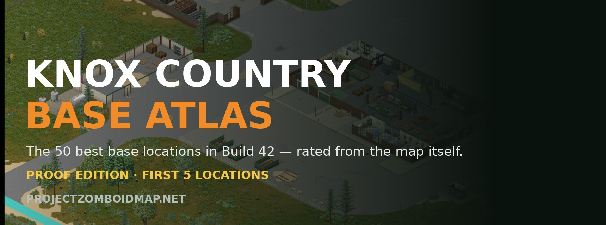

# Knox Country Base Atlas

**The 50 best base locations in Project Zomboid Build 42 — rated from the map itself.**

Every "best base" list on the internet is one player's opinion. This one starts
from measurements. Zombie pressure around each base is computed from the game's
own population layer, water and loot are read off the world and the item
database, and every score in this repository can be reproduced with the script
in `tools/`.

> **Proof edition.** The first 5 locations are scored and published. The list
> grows to 50 in the open — watch the repository or download the PDF below.

**[Open the Project Zomboid B42 map](https://projectzomboidmap.net)** ·
**[Download the Atlas PDF](Knox-Country-Base-Atlas-proof-edition.pdf)** ·
**[itch.io](https://projectzomboidmap.itch.io/)** ·
**[Knox Country Safehouse Jam](https://itch.io/jam/knox-country-safehouse-jam)** ·
**[ModDB](https://www.moddb.com/mods/project-zomboid-map-interactive-b42-map-item-database)**

## The first five

| # | Location | Town | Coords | Overall |
|---|----------|------|--------|---------|
| 1 | Carlow Road Farmhouse | West Point outskirts | 10775, 7144 | **68** |
| 2 | Rosewood Fire Station | Rosewood | 8143, 11737 | **63** |
| 3 | McCoy Logging Warehouse | Muldraugh | 10301, 9429 | **63** |
| 4 | Riverside Auto Shop | Riverside | 5836, 5379 | **60** |
| 5 | Mainslick Road Fenced House | Doe Valley, Louisville | 12950, 3060 | **40** |

Yes — the quiet farmhouse beats the famous fire station. The fire station is
still a superb base; it just sits in the middle of the most crowded ground in
Rosewood, and the numbers refuse to pretend otherwise. That is the whole idea
of this Atlas.

Full entries — map crops, every sub-score and the reasoning — are in
[`data/locations.json`](data/locations.json), [`data/locations.csv`](data/locations.csv)
and the PDF.

## How a base is scored

* **Zombie pressure (measured).** Two aligned renders of the same view, the
  population layer off and on, are compared pixel by pixel. The layer's blue
  overlay strengthens with density, so coverage and intensity combine into a
  0–100 pressure score. Safety is 100 − pressure. Method and code:
  [`tools/score_locations.py`](tools/score_locations.py).
* **Loot (0–10).** What the building and its immediate neighbours hold,
  checked against the item database — a fire station scores on axes and tools,
  a logging warehouse on building material.
* **Water (0–10).** Distance to open water you can actually use: a pond on
  the same street is not the same as a river a ten-minute drive away.
* **Defense (0–10).** Perimeter, floors and entry points the building already
  has before you place a single plank.

**Overall** = 0.30·Safety + 0.30·Loot + 0.15·Water + 0.25·Defense (loot,
water and defense scaled to 100).

Disagree with a score? The editorial inputs live in
`data/locations_input.json` — open an issue and argue with evidence. That is
what the data is published for.

## Repository layout

```
data/     locations.json / locations.csv — the scored locations
          locations_input.json — the auditable editorial inputs
crops/    a zoomed map render for every location
tools/    score_locations.py — reproduces every number in data/
assets/   banner and page art
```

## Roadmap to 50

* Louisville's gated mansions and the mall district
* March Ridge military housing
* The Rosewood prison perimeter farms
* Ekron, Brandenburg and the river towns
* A beginner's five and a no-vehicle five, as separate cuts of the same data

## Ground covered

The Atlas scores bases across the whole of Build 42's Knox Country —
Louisville and its suburbs, West Point, Muldraugh, Rosewood, Riverside,
Brandenburg, Ekron and Doe Valley, plus the farms, warehouses and gas
stations between the towns. Every location is checked on the interactive
map itself: the same renders, the same population layer, the same item
data any player can open.

## Questions people ask

**Why does an unknown farmhouse outscore the Rosewood Fire Station?**
Because the scoring counts what is around a base, not just what is in it.
The fire station holds superb loot and sits in Rosewood's most crowded
ground; the farmhouse holds less and is surrounded by almost nothing.
Both scores are printed in full — pick the trade-off you prefer.

**Can I check a score myself?** Yes. The inputs live in
`data/locations_input.json`, the method in `tools/score_locations.py`,
and the renders come from the interactive map linked at the top of this
page.

**Will my favourite base be added?** The list grows to fifty — see the
roadmap above. Open an issue with the coordinates and the case for it;
evidence wins arguments here.

## Credits and license

Map renders and item data come from
[ProjectZomboidMap.net](https://projectzomboidmap.net), an unofficial fan
project. Project Zomboid and Knox Country belong to The Indie Stone; this
Atlas is a community work and is not affiliated with them.

Code is MIT (see `LICENSE`). The location data is CC BY 4.0 — use it, credit
the Atlas.
